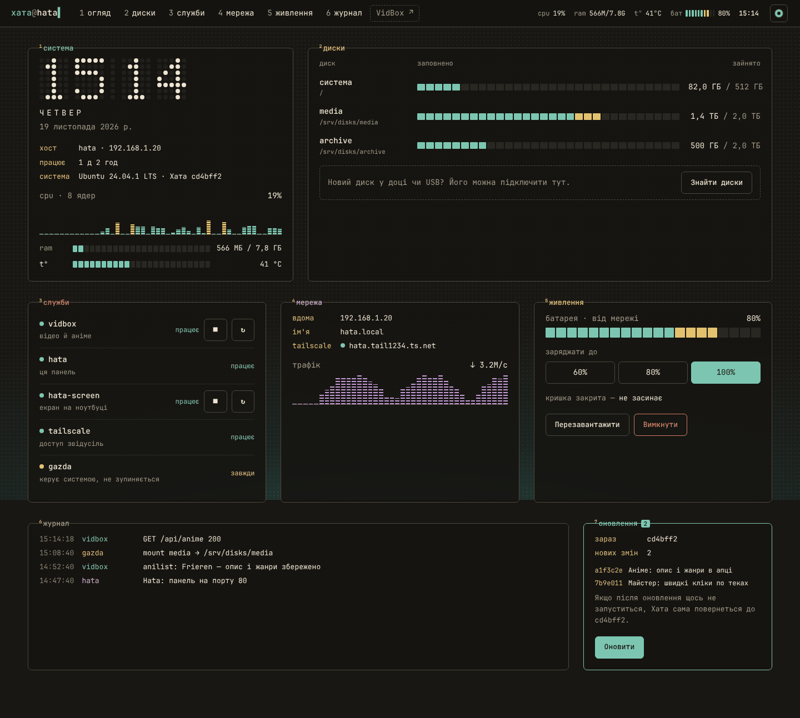
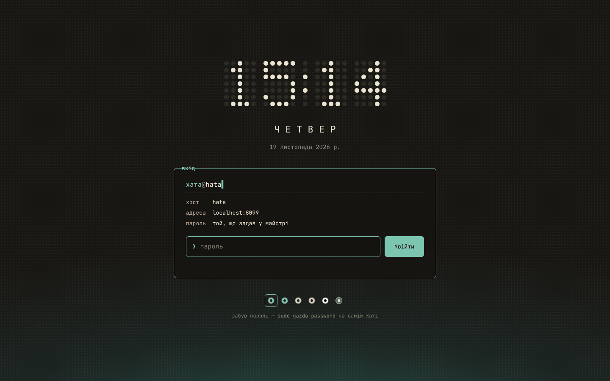
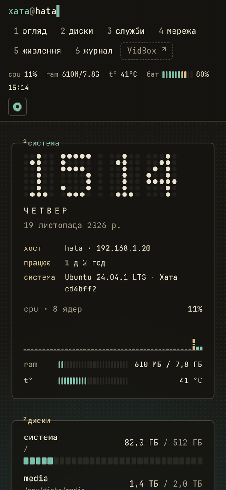
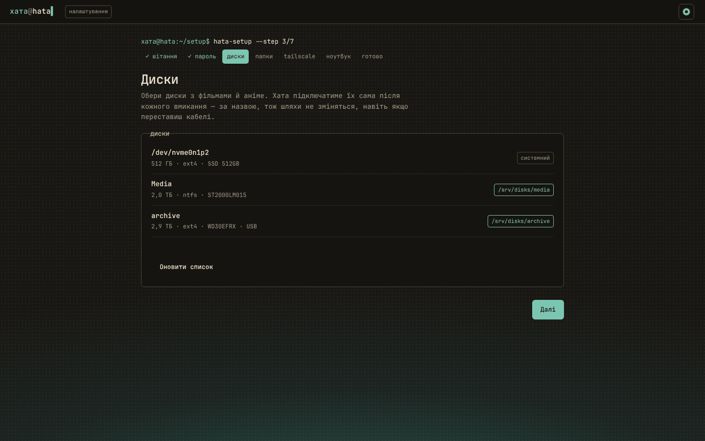
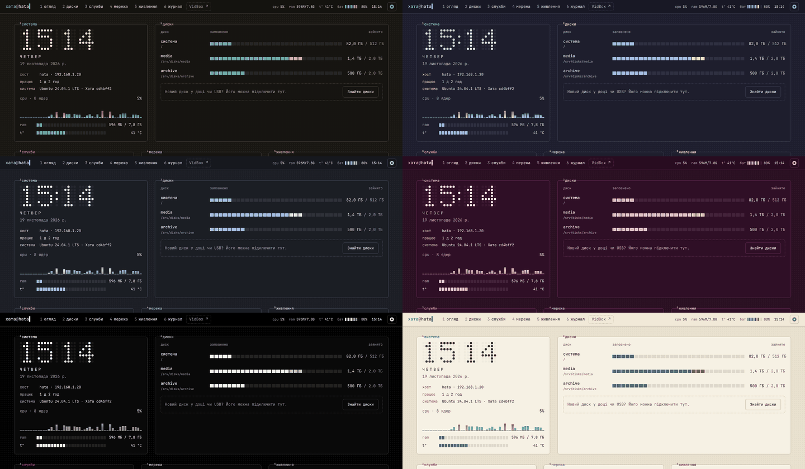

# Hata

Власний домашній сервер на Ubuntu Server: одна графічна панель у термінальному стилі,
диски, мережа, доступ звідусіль через Tailscale — і застосунки поверх неї.
Перший застосунок — **VidBox**, домашній відеосервер з сайтом і Android-апкою.

Робиться під себе, але так, щоб будь-хто міг поставити її на свій комп'ютер.

## Як виглядає



<table>
<tr>
<td width="68%"></td>
<td></td>
</tr>
<tr><td>Вхід</td><td>На телефоні</td></tr>
</table>



Шість кольорових схем — чай, ніч, lain, ягода, nothing і світлий папір. Вибрана схема фарбує й екран ноутбука.



<sub>Знімки зроблено в демо-режимі: `HATA_DEMO=1 HATA_PORT=8080 python3 core/hata.py`.</sub>

## Встановлення

1. Постав **Ubuntu Server 24.04 LTS** (або Debian 12/13) на комп'ютер чи ноутбук, який стане сервером.
2. Виконай:

   ```sh
   git clone https://github.com/AfricaEE112/hata && sudo hata/install.sh
   ```

3. На екрані сервера з'явиться QR-код. Відскануй його телефоном (або відкрий `http://hata.local`)
   і пройди майстер: пароль → диски → папки → Tailscale → ноутбук → готово.

Інсталятор можна запускати повторно — він лише доставить відсутнє й оновить код.
Далі Hata оновлюється кнопкою в панелі; якщо нова версія не запуститься, сама повернеться на попередню.

## Що всередині

| Тека | Що це |
|---|---|
| `install.sh` | інсталятор: пакети, служби, кришка ноутбука, `hata.local`, оновлення безпеки |
| `core/hata.py`, `core/web/` | панель і майстер налаштування (Python без сторонніх бібліотек, чисті HTML/CSS/JS) |
| `core/files.py`, `core/house.py` | розділи «Файли» (менеджер файлів і завантаження) та «Будинок» (заміри від плати ESP32 RoomMonitor: температура, світло, інтернет) |
| `core/gazda.py` | **gazda** — єдина частина з правами root; виконує лише дії з білого списку. У терміналі: `sudo gazda status` |
| `core/screen.py` | статус і QR-код на екрані ноутбука замість логіна |
| `core/systemd/` | служби: `gazda`, `hata`, `hata-screen`, `vidbox` |
| `apps/vidbox/` | **VidBox**: сервер (`vidbox.py`), сайт (`web/`), Android-апка (`android/`). Див. [apps/vidbox/README.md](apps/vidbox/README.md) |
| `NOTES.md` | план робіт і рішення |

Перевірити інтерфейс Hata без сервера: `HATA_DEMO=1 HATA_PORT=8080 python3 core/hata.py`.

## Принципи

- Керування — графічне; термінал лише як запасний вхід.
- Простий код: без фреймворків, збирачів і Docker; один модуль — один файл.
- Hata не має приносити проблем: служби незалежні від панелі, оновлення з відкатом,
  системні дії — лише з білого списку, помилки пояснюються людською мовою.
- Панель доступна вдома й через Tailscale, ніколи не відкривається в інтернет.

## VidBox на Windows без Hata

VidBox і далі можна запускати окремо на Windows: `start.bat` у корені (або `apps/vidbox/start.bat`).
